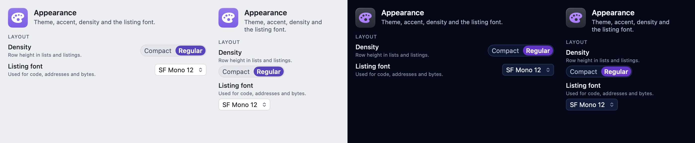
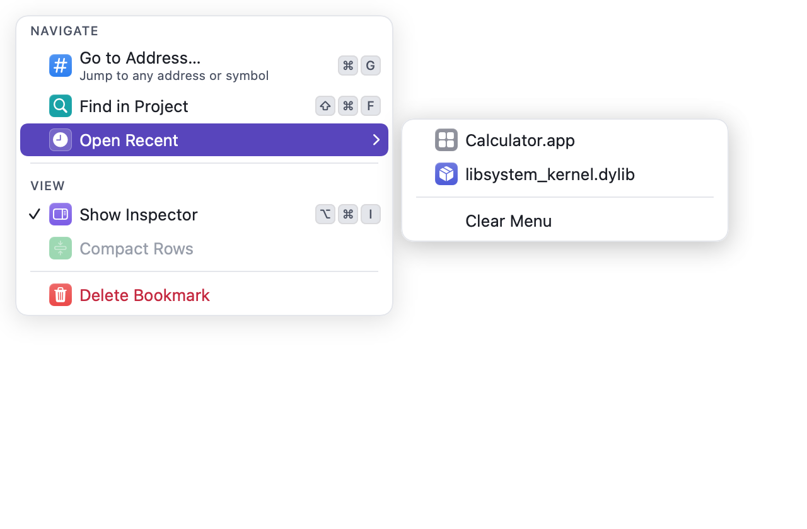
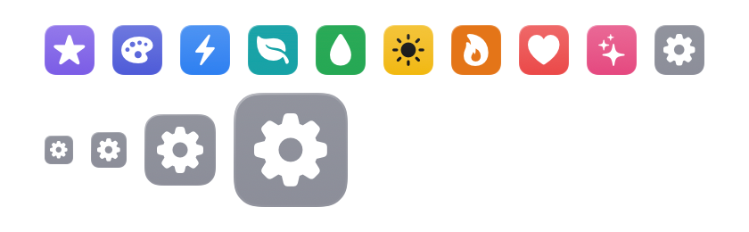
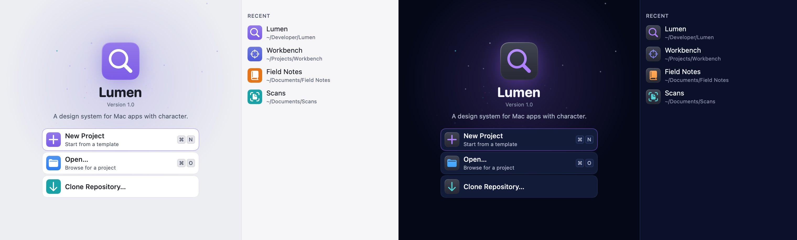
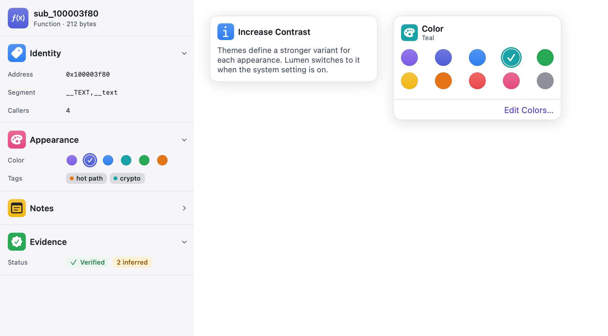
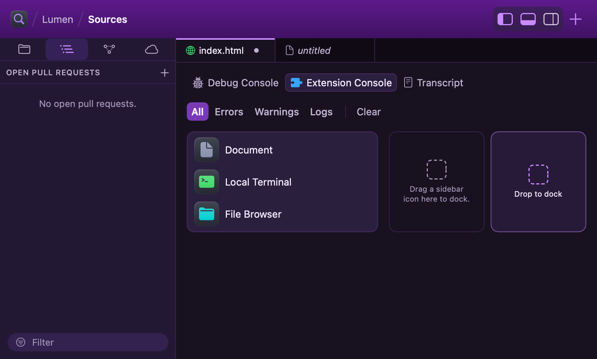
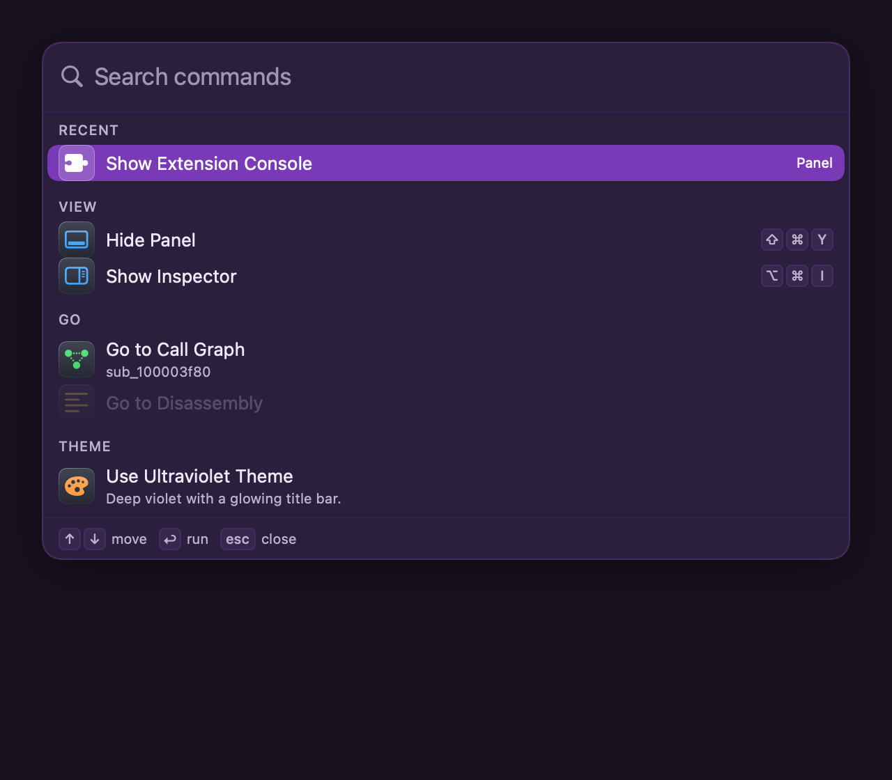
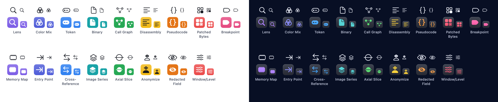

# Lumen

A design system for macOS apps: color roles as data, themes users can import and edit, and a
validator that proves text and controls stay readable in light, dark and Increase Contrast.
Lumen serves several apps, each with its own identity.

Repository: https://github.com/jdotc1/LumenUI

- **macOS 14+**, Swift 6, SwiftUI first with AppKit where it matters.
- **`LumenTokens`:** tokens, packs, registry, themes, validator, export. Plain Swift, no UI.
- **`LumenUI`:** theme store, palette environment, metrics, density, components, and the theme
  gallery, editor and library.
- **`LumenConformance`:** checks an app runs in its own tests at each Lumen pin bump: themes,
  layout, shortcuts, color coverage, the workspace window, truncation, icon scale, overflow,
  surface steps, tile backlight, visible duplicates and narrow sizing. Apps add their own
  `LumenCheck` rules and run them with the same context and finding format. For app test targets;
  the Catalog also lists check metadata.
- **`lumen-theme`:** a command-line tool that validates theme files and exports the reference.
- **Lumen Catalog** (`swift run LumenCatalog`): every component in a real Mac app, including native
  menus with Lumen tiles, the command menu, a Settings window with colored tabs, a welcome window,
  a live toolbar, an inspector, popovers, Lumen's glyphs, live pages for forms and controls, search
  and navigation, data and Git, and browsing, and a workspace window. Launch options
  for screenshots and demos: `LUMEN_CATALOG_PAGE=<page>`, `THEME=<theme id>`, `APPEARANCE=light|dark`,
  `CHROME=glass|drawn` (the chrome style, Docs/GLASS.md), `WORKSPACE=1`, `SPLIT=1` (a split workspace window), `WELCOME=1`, `SETTINGS=1`, `PALETTE=1|<query>`, `COMMANDS=1`, `POPOVER=1`,
  `LAUNCH=<seconds>`, `DOCK=1`, `PANEL=<tab>`, `INSPECTOR=0`, `ACTIVITY=working`, `SCROLL=bottom` and
  `LOGSTREAM=1` (a log line every 0.3 s), each prefixed `LUMEN_CATALOG_`.

Start with [Docs/PRINCIPLES.md](Docs/PRINCIPLES.md) (compatible with macOS, drawn by Lumen) and
[Docs/ARCHITECTURE.md](Docs/ARCHITECTURE.md). Releases and what each changes are in
[CHANGELOG.md](CHANGELOG.md). [Docs/KEYBOARD.md](Docs/KEYBOARD.md) covers keyboard
operation, shortcuts, menu bar commands and click targets. The generated token
reference and theme JSON Schema are in [Docs/reference](Docs/reference).



| Menus: native menus with tiles, and the command menu | Icon tiles: the hue family |
|---|---|
|  |  |














## Components

Every view below appears in the Catalog, on its own or inside a larger one, unless it's marked
(not in the Catalog); where to look is in brackets. The theming and layout lines list the APIs
behind them.

- **Chrome & workspace:** `LumenToolbarIdentity`, `LumenActivityStatus`, `LumenTaskCluster`,
  `LumenToolbarBreadcrumb`, `LumenPanelToggles`, `LumenNewItemButton` with `.lumenLaunchMenu`,
  `.lumenWindowChrome`, `.lumenBottomPanel`, `LumenTopBar`, `LumenSplitEditor`, `LumenDocumentTabBar`,
  `LumenTabOverview`, `LumenStatusBar`, `.lumenFloatingStatus`, `LumenWelcomeView`, `LumenWelcomePanel`,
  `LumenStarfield`, `LumenAppIcon`, `LumenWorkspaceWindow` (with `LumenWorkspacePanels`,
  `LumenTopBarPlacement`; not in the Catalog), `LumenWorkspaceToolbar`, `LumenToolbarStatus`, `LumenToolbarDivider`,
  `LumenToolbarGroup`, `LumenNavigationButtons` (not in the Catalog), `LumenContentTabBar`, `LumenTitlebarBackground`,
  `LumenPanelToggle`, `LumenPanelDeckControls`, `LumenWindowDragArea`, `.lumenTopBar`,
  `.lumenToolbarDimming` (not in the Catalog), `LumenToolbarIconButtonStyle` (`.lumenToolbarIcon`),
  `LumenPanelIconButtonStyle` (`.lumenPanelIcon`, `.lumenPanelIcon(isOn:)`), `LumenDropZone` [Toolbar, Welcome, Workspace, Browse (tab overview), States & Rows, Components; the
  Workspace and Split Workspace windows].
- **Sidebars & panels:** `LumenSourceList`, `LumenSidebarSwitcher`, `LumenSidebarSection`,
  `LumenSidebarCountSection`, `LumenStackedSidebar`, `LumenSidebarPaneGrid`, `LumenFilterField`,
  `LumenPanelTabs`, `LumenPanelBar`, `LumenPanelDeck`, `LumenLogConsole`, `LumenLogFilterBar`,
  `LumenSidebarHeader`, `LumenSidebarActions`, `LumenInspector` pieces (`.lumenInspector`,
  `LumenInspectorHeader`, `LumenInspectorRow`, `LumenInspectorToggle`, `LumenInspectorPane`,
  `LumenInspectorSection`, `LumenInspectorSummary`, `LumenReferenceRow`), `.lumenInspectorEmptyState`
  (not in the Catalog), `LumenStatusMenu` [Workspace, Components, States & Rows,
  Editor; the Workspace and Split Workspace windows].
- **Settings & forms:** `.lumenSettingsTab`, `LumenSettingsPane`, `LumenSettingsSidebarView`,
  `LumenSettingsRow` (with a badge), `LumenSettingsCard`, `LumenSentenceRow`, `LumenNumberField`,
  `LumenCheckboxGrid`, `LumenDependentGroup`, `LumenInheritedPicker`, `LumenIntegrationRow`,
  `LumenListEditor`, `LumenMasterDetail`, `LumenFieldList`, `LumenWizardStep`, `LumenManagedToolRow`,
  `LumenAppearanceSettings`, `LumenSettingsHeader`, `LumenSheet`, `LumenFormSection`, `LumenFormRow`,
  `LumenFieldRow`, `LumenInlineField`, `LumenFlowLayout` [Settings, Sheets & Settings, Forms & Controls].
- **Controls & editors:** `LumenSwitch`, `.lumenCheckbox` (`LumenCheckboxStyle`), `LumenRadioGroup`,
  `LumenRadioButton`, `LumenTabbedBox`, `LumenTable` (`LumenTableText`), `LumenSlider`, `LumenTextField` (not in the Catalog),
  `LumenComboField`, `LumenPopUp`, `LumenPopUpLabel`, `LumenPullDownButton`, `LumenKeyValueEditor`,
  `LumenRuleEditor`, `LumenModeSwitcher`, `LumenHelpButton`, `LumenInfoButton`, `LumenHuePickerButton`,
  `LumenHueSwatchPicker`, `LumenColorWell`, `LumenColorGrid`, `LumenSwatchStrip`, `LumenSwatchMenuLabel`,
  `LumenIconPicker`, `LumenPermissionsGrid`,
  `LumenFontPicker`, `LumenCodeFontPicker`; button styles `.lumenPrimary`, `.lumenQuiet`, `.lumenTinted`,
  `.lumenPlain` [Forms & Controls, Popovers, States & Rows, Debugger].
- **Search & navigation:** `.lumenCommandPalette` with `LumenPaletteScope`, `LumenCommandMenu`,
  `LumenMenuLabel`, `LumenFindPanel`, `LumenSearchResults`, `LumenHighlightedText`,
  `LumenInputPalette` with `LumenGoToLine` (`.lumenInputPalette`; `.lumenGoToLine` isn't in the Catalog),
  `LumenCompletionList`, `LumenShortcutRecorder`,
  `LumenFilterChips`, `LumenAddressField`, `.lumenCommandMenu`, `.lumenPanelCommands`, `.lumenPaneCommands`,
  `.lumenMenuOwnsShortcuts`, `.lumenFocusRing`, `LumenViewCommands` (see Docs/KEYBOARD.md) [Menus, Search & Navigation, ⌘K anywhere; the Split Workspace
  window].
- **Data & history:** `LumenNoticeCard` and `.lumenNotices`, `LumenOutlineControls`, `LumenHistoryRow`,
  `LumenRefPill`, `LumenAvatar`, `LumenComparisonHeader`, `LumenDiffNavigator`, `LumenMinimap`,
  `LumenChecklistTree`, `LumenCommitComposer`, `LumenStatsCard` (`LumenStatCell`) [Data & Git; the Split Workspace window].
- **Debugger & code:** `LumenStackFrameList`, `LumenRegisterGrid`, `LumenConsole`, `LumenBreakpointRow`,
  `LumenHexDump`, `LumenCommandField`, `LumenWatchList`, `LumenVariableTree`, `LumenCodeListing`,
  `LumenStatusStrip`, `LumenBranchLanes`, `LumenStringRow`, `LumenStringLiteral`, `LumenGraphNode`
  (`LumenGraphEdgeKind`, `LumenGraphEdgeBadge`), `LumenProcessList`, `LumenVariableRow`,
  `LumenEvaluationResult`, `LumenBreakpointMarker`, `LumenProgramCounterMarker`, `.lumenListingRow`
  (`LumenListingRowState.patchMark`), `LumenHexStyle`, `.lumenCodeFont` (`LumenCodeFont`), `LumenLineNumberRuler` (AppKit)
  [Debugger, Editor, Sheets & Settings].
- **Browse:** `LumenCollection` and `LumenCollectionControls`, `LumenCarousel`, `LumenItemCard`,
  `LumenDetailHeader` [Browse].
- **States & feedback:** `LumenBadge`, `LumenPill`, `LumenTag`, `.lumenTagTint` (not in the Catalog), `LumenCount`,
  `LumenSectionHeader`, `LumenSymbol`, `LumenSymbolBadge`, `LumenSentenceText`, `LumenKeycap`, `LumenEmptyState`
  (`LumenEmptyState.Prominence` `.inline`/`.pane`, `LumenEmptyState.inline(_:ink:leading:padding:)`,
  `.lumenEmptyMessage`), `LumenEmptyHero`, `LumenBanner`, `LumenLoadingState`, `LumenErrorState`, `LumenProgressBar`,
  `LumenProgressRing`, `LumenListRow` (`LumenRowState`, `.lumenRowBackground`), `LumenPropertyRow`,
  `LumenStatusRow`, `LumenCodeSample`, `LumenStatusLabel`, `.lumenPopover` (`LumenPopoverContent`), `.lumenCompactControl`
  (not in the Catalog), `LumenIconTile`, `LumenGlyph` (`LumenGlyphView`) [Components, States & Rows, Forms & Controls, Popovers,
  Icon Tiles, Glyphs].
- **Theming:** `LumenThemeStore`, `.lumenPaletteRoot`, `.lumenMetrics`, `.lumenDensityRoot`,
  `.lumenSurface`, `LumenThemeGallery` (with `LumenThemeCard`, `LumenThemeMiniature`, `LumenThemeEditor`
  and theme import), `LumenUserThemeLibrary`, `LumenShowcase` [Themes].
- **Surfaces & depth:** `.lumenCard`, `.lumenRaisedGround`, `.lumenElevation` (`LumenElevation`),
  `.lumenGlow`, `.lumenTileBacklight`, `.lumenAmbientWash` (`LumenAmbientWash`) [Components, Welcome,
  Workspace].
- **Layout and rules:** `LumenLayout`, `.lumenColumn`, `.lumenSidebarColumn`, `.lumenSidebarBackground`,
  `.lumenColumnContent`, `.lumenFixedContainer`, `.lumenNeverTruncates`, `.lumenWrapsWithoutTruncating`,
  `.lumenIconRole`, `.lumenIconOnlyControl`, `.lumenRendersOffscreen`, `LumenSnapshot` (offscreen
  renders for goldens; `LumenSnapshot.Renderer` `.image` or a never-shown `.window`);
  the checks that read them are in `LumenConformance` (used throughout the Catalog).

## Concepts in one minute

- A **token** is a color role: `bg.canvas`, `fg.secondary`, `accent.default`. Lumen's core pack
  defines the roles every app shares: surfaces, text, accent, status, the hue family, window
  chrome, menus, panels, the welcome window and the workspace (the full list is in
  [Docs/reference](Docs/reference), which covers the core pack only). Optional packs add code and
  syntax roles (`LumenPack.code`) and chart series (`LumenPack.chart`). Your app adds its own roles
  in a **pack**.
  - `LumenPack.code` (`LumenToken.Code`, 18 roles): `syntax.keyword`, `.type`, `.function`,
    `.variable`, `.string`, `.number`, `.comment`, `.operator`, `.punctuation`; `code.currentLine`,
    `.programCounter`, `.selection`, `.lineNumber`; `diff.addedBackground`, `.removedBackground`,
    `.changedBackground`, `.addedForeground`, `.removedForeground`.
  - `LumenPack.chart` (`LumenToken.Chart`, 11 roles): `chart.series1` … `chart.series8`,
    `chart.grid`, `chart.axis`, `chart.label`.
  - Their specs (fallbacks, contrast) and built-in values are in `Sources/LumenTokens/LumenPacks.swift`.
- Each token has a **spec**: its group, its fallback (a semantic role every theme defines, or a
  default such as another role or a tint over a background), the **surface** whose theme draws
  it, and the contrast it must reach.
- A **theme** is JSON. It usually `inherits` a built-in and overrides a few colors. Unknown keys
  are kept, so one theme file works across apps.
- The **validator** checks every theme against every spec and rule. The theme editor, the
  gallery and import all use it.

## Adding Lumen to an app

```swift
// Package.swift
.package(url: "https://github.com/jdotc1/LumenUI", from: "0.56.0")
// target
.product(name: "LumenUI", package: "Lumen")
```

### Your app's pack

```swift
import LumenTokens

extension LumenToken {
    static let paperHeader: LumenToken = "paper.header"
}

extension LumenPack {
    static let myApp = LumenPack(
        id: "com.example.myapp",
        tokens: [
            LumenTokenSpec(.paperHeader, group: "Paper", fallback: .composite(.accent, alpha: 0.06, over: .bgCanvas)),
        ],
        themes: [/* your branded themes, usually inheriting lumen.standard */]
    )
}

let registry = LumenRegistry(packs: [.core, .myApp])
```

### Install the store and apply the root modifiers

```swift
import LumenUI

@main struct MyApp: App {
    init() {
        LumenThemeStore.install(LumenThemeStore(
            registry: registry,
            configuration: LumenStoreConfiguration(appName: "MyApp", defaultThemeID: LumenThemes.standardID)
        ))
    }

    var body: some Scene {
        WindowGroup {
            ContentView()
                .lumenPaletteRoot()
                .lumenMetrics(.standard)          // or your app's metrics: fonts, spacing, corners
                .lumenDensityRoot()
        }
        Settings { LumenThemeGallery() }          // theme picker, per-surface pickers, editor, import/export
    }
}
```

Then draw with roles, not colors:

```swift
Text("Signed").foregroundStyle(.lumen(.statusSuccess))
LumenBadge("3 warnings", tone: .warning)
LumenEmptyState(systemImage: "doc", title: "No documents", message: "Import a document to begin.")
LumenEmptyState("No matching documents", prominence: .inline)          // an empty list: one quiet sentence
```

Expressive pieces, all theme-driven:

```swift
LumenIconTile("paintpalette.fill", hue: .hueViolet, size: 40)           // System Settings-style tile
Button {} label: { LumenMenuLabel("Open Recent", systemImage: "clock.fill", hue: .hueOrange) }  // in a native Menu
LumenCommandMenu(entries)                                                // quick actions, submenus, keycaps
GeneralPane().lumenSettingsTab("General", systemImage: "gearshape.fill", hue: .hueGraphite)  // Settings tab
LumenSettingsPane("General", systemImage: "gearshape.fill", hue: .hueGraphite, summary: "…") { /* native Form rows */ }
```

A welcome window and a toolbar with live task state:

```swift
Window("Welcome to Field Notes", id: "welcome") {
    LumenWelcomeView(appName: "Field Notes", version: "2.1", tagline: "Notes from the field, in order.",
                     markSymbol: "book.closed.fill", markHue: .hueOrange,
                     actions: [LumenWelcomeAction("New Notebook", systemImage: "plus", hue: .hueOrange,
                                                  shortcut: KeyboardShortcut("n"), isPrimary: true) { newNotebook() }],
                     recents: recents, showAtLaunch: $showWelcome) { open($0) }
        .lumenPaletteRoot()
}
.windowStyle(.hiddenTitleBar)
.windowResizability(.contentSize)

// In the main window. The toolbar stays native; Lumen fills its items.
.toolbar {
    ToolbarItem(placement: .navigation) { LumenToolbarIdentity("Field Notes", subtitle: path, systemImage: "book.closed.fill", hue: .hueOrange) }
    ToolbarItem(placement: .principal) { LumenActivityStatus(activity) }    // .idle(), .working(…, progress:), .succeeded("…"), .failed("…")
    ToolbarItem(placement: .primaryAction) { LumenTaskCluster(tasks, activity: activity) }  // start and stop follow the activity
}
```

For a split view, share its visibility binding with the sidebar modifier:

```swift
@State private var columns: NavigationSplitViewVisibility = .all

NavigationSplitView(columnVisibility: $columns) {
    sidebar.lumenSidebarToggle(columnVisibility: $columns)
} detail: {
    detail
}
```

The resolved chrome style chooses a bare outline button matching the inspector in `.drawn` and the system
sidebar toggle in `.glass`, including runtime changes. Native sidebar menu commands still work.
Apply `.lumenToolbarPlatter(chromeStyle)` to your other toolbar items. A `ToolbarItem` containing
`LumenToolbarIdentity` directly automatically stays bare in both styles; keep identities in their
own item, separate from control groups. For a status that yields
space before controls overflow, use `LumenToolbarStatus(activity, minWidth: 180)`
after the identity with `.navigation` placement. It measures the full label and percentage, then
limits the capsule to the room left by the live native toolbar items, including AppKit's spacing.
Only a shortage of room causes middle truncation; at the minimum, native overflow applies.
The older `idealWidth:minWidth:` initializer forwards to this behavior and is deprecated.
Existing `width:` initializers retain their behavior.

An inspector and popovers. Both stay native (`.inspector`, `.popover`); Lumen lays out what's inside:

```swift
.lumenInspector(isPresented: $showsInspector) {                          // ⌥⌘I via LumenInspectorToggle
    LumenInspectorHeader("Survey", subtitle: "Notebook", systemImage: "book.closed.fill", hue: .hueOrange)
    LumenInspectorSection("Appearance", systemImage: "paintpalette.fill", hue: .huePink) {
        LumenInspectorRow("Color") { LumenHuePickerButton(selection: $hue) }    // swatches in a popover
        LumenInspectorRow("Pages") { Stepper("Pages", value: $pages) }         // native controls
    }
}
LumenInfoButton("Sync", message: "Notebooks sync when the Mac is on power.")  // ⓘ with an explanation
Button("Share…") { sharing = true }
    .lumenPopover(isPresented: $sharing, title: "Share Notebook", systemImage: "square.and.arrow.up.fill", hue: .hueBlue) { … }
```

A workspace window, after Nova: the title bar glows while the window is active, panel toggles show
which regions are open and slide them in and out, and the panes carry their own tabs, filters and
consoles. The structure stays native (NavigationSplitView, `.inspector`, the toolbar, menus, tables):

```swift
NavigationSplitView { sidebar } detail: {
    editor
        .lumenBottomPanel(isPresented: $showsPanel) {                       // slides, resizes by its top edge
            LumenPanelTabs(selection: $tab, tabs: tabs)                      // capsule tabs, hued icons
            LumenLogConsole(entries) { entries = [] }                        // source menu, filter, level chips, Clear, native table
        }
        .inspector(isPresented: $showsDock) { LumenDropZone() }
}
.toolbar {
    ToolbarItem(placement: .navigation) { LumenToolbarBreadcrumb(["Lumen"], systemImage: "lumen.lens", hue: .hueViolet) }
    ToolbarItem(placement: .primaryAction) {
        LumenPanelToggles(leading: $showsSidebar, bottom: $showsPanel, trailing: $showsDock)  // ⌃⌘S ⇧⌘Y ⌥⌘I
    }
    ToolbarItem(placement: .primaryAction) {
        LumenNewItemButton { showsNew = true }.lumenLaunchMenu(isPresented: $showsNew, items: newItems)
    }
}
```

`.lumenPaletteRoot()` paints the active-window glow; `.lumenWindowChrome()` adds it to a window
without that root.

A command palette (⌘K) finds any command by typing, forgivingly ("tgp" finds Toggle Panel), lists
recent commands first and shows each one's shortcut:

```swift
content.lumenCommandPalette(isPresented: $showsPalette, commands: [
    LumenCommand("Hide Panel", category: "View", systemImage: "rectangle.bottomthird.inset.filled",
                 shortcut: LumenShortcuts.panel) { showsPanel.toggle() },
    LumenCommand("Go to Call Graph", category: "Go", systemImage: "lumen.callGraph", hue: .hueGreen,
                 keywords: ["functions", "callers"]) { … },
])
```

The sidebar gets `LumenSidebarSwitcher` (⌘1…⌘9), `LumenSidebarSection` and `LumenFilterField`; the
editor gets `LumenDocumentTabBar` and `LumenStatusBar` with `LumenStatusMenu`s. The **Ultraviolet**
theme is the look from the recording: deep violet grounds, violet hairlines and a magenta title bar
glow, with one neon violet accent for the tab line, selected chips and toggles.

Glyphs: symbols SF Symbols doesn't have (call graphs, disassembly, breakpoints, image series,
anonymization and more). Each draws as an SF Symbol: a custom one built from Apple's geometry, or an
SF equivalent. Pass a glyph's name anywhere Lumen takes a `systemImage`, or draw its original
24-point drawing directly with `LumenGlyphView`:

```swift
LumenIconTile(LumenGlyph.callGraph.symbolName, hue: .hueGreen, size: 28)   // "lumen.callGraph"
LumenBadge("Anonymized", systemImage: "lumen.anonymize", tone: .success)
LumenGlyphView(.breakpoint, size: 24).foregroundStyle(.lumen(.accent))
Label { Text("Breakpoints") } icon: { LumenGlyph.breakpoint.image() }  // template image for native menus
LumenGlyph.register([myAppGlyph])                                          // an app's own, by the same rules
```

Popover text uses the system's vibrant label styles. Theme text colors are validated against theme
surfaces, not against the popover material, which the system draws; the tile carries the color.

`.lumenPaletteRoot()` also tints native controls with the theme's accent. Native list selection
follows the app's `AccentColor` asset, so set that asset to your accent too.

Dense views read the resolved palette once (`@Environment(\.lumenPalette)`) instead of calling
`store.color(_:)` per cell. Sizes, fonts and corners come from `@Environment(\.lumenMetrics)`.
(`Lumen.color` and `Lumen.nsColor` are deprecated and go away in 1.0: they read the shared store
whatever window they're in.)

### More than one store

`install(_:)` is the convenience for an app with one store. A window that draws with its own
themes (a document with a per-window theme, a preview of one theme) gets a store of its own and
its own root; every Lumen view below it, the gallery and Appearance settings included, reads that
store from the environment, and the shared store is untouched:

```swift
let preview = LumenThemeStore(configuration: .init(appName: "MyApp"), registry: registry)  // persists nothing
preview.select(LumenThemes.ultravioletID)
PreviewWindow().lumenPaletteRoot(store: preview)
```

`LumenSnapshot.verify(_:named:size:store:colorScheme:goldenDirectory:)` renders against such a
store without making it active, so a view that still reads the shared store shows up in its golden.
`.lumen(_:)` reads the active store; inside a second store's window read
`@Environment(\.lumenPalette)` instead.

### Validate themes in your tests

```swift
for theme in registry.builtInThemes {
    XCTAssertEqual(LumenValidator.issues(for: theme, in: registry).map(\.message), [])
}
```

### From the command line

```sh
swift run lumen-theme validate MyTheme.json
swift run lumen-theme export Docs/reference
```

## Development

```sh
swift build --scratch-path /tmp/lumen-build
swift test --scratch-path /tmp/lumen-build
```

Keep build output outside the repository.

## License

Lumen's code is available under the MIT license. See LICENSE.

## Symbols

Lumen's custom symbols are derived from Apple SF Symbols geometry and remain subject to Apple's
SF Symbols / Xcode license terms (System-Provided Images, §2.10). They are not covered by the
MIT license and are for use in apps on Apple platforms only.

Apple's terms do not allow app icons built from SF Symbols. Use the symbol-based artwork
provided by `LumenDockIcon` for in-app tiles only, not as an app or Dock icon. The Catalog uses
its packaged procedural `Design/LumenCatalog.icon` artwork.

## App conformance checks

A3 ships the `LumenCheck` protocol, runner, twelve refit checks, and `forbiddenSourcePatterns`.
Keep conformance in your app's test target. Existing static checks continue to work; custom
`LumenCheck` types provide an `id`, `title`, optional `owner` (default `"Lumen"`), and
`@MainActor func run(in context: LumenCheckContext) -> [LumenConformance.Finding]`.

```swift
@MainActor
func checkAppSources(_ files: [URL]) -> [LumenConformance.Finding] {
    LumenConformance.run([
        LumenConformance.forbiddenSourcePatterns(
            [".foregroundStyle(.primary)", ".foregroundStyle(.secondary)"], in: files)
    ], in: [LumenCheckContext()])
}
```

For a view, pass a named `AnyView` subject, sizes, registry, themes and snapshot variants in the
context. A minimum-text-size check and a label check are deferred until the renderer exposes resolved text sizes and the SwiftUI accessibility tree.

The source helper matches literal text, including comments and strings, and reports unreadable
files. Workbench's staged `WorkbenchStyleRatchet` shows how an app can allow a fixed occurrence
budget and fail above it. The Catalog's Conformance page groups app checks by `owner` without
running them. The runner preserves context/check ordering and the existing finding format.
